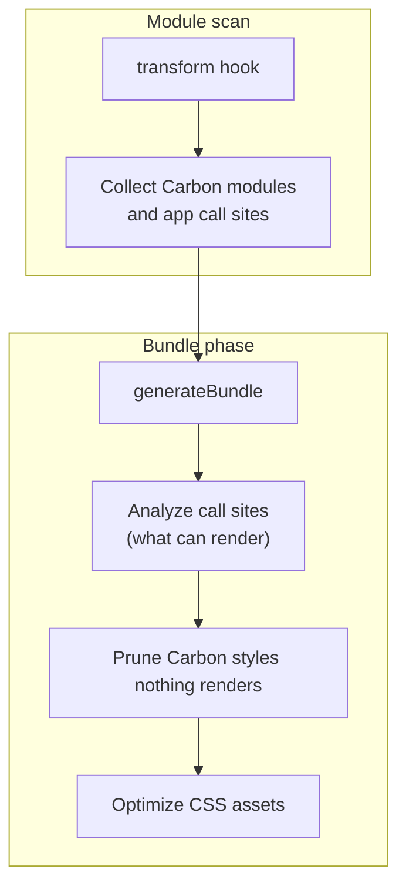

# `optimizeCss`

A build plugin that strips unused Carbon styles. It runs on Vite, Rollup and [Rolldown](https://rolldown.rs), which share a plugin API.

```
$ vite build
…
carbon-preprocess-svelte: pruned Carbon CSS
  assets/index-CU4gbKFa.css  606.3 kB  →  53.2 kB  -91%
```

> [!NOTE]
> It's a build plugin, not a preprocessor: add it to `plugins`. Vite runs it on `vite build` only; under Rollup and Rolldown, add it to production builds only.

<details>
<summary>How it works</summary>

It runs on production builds, after other plugins (`apply: "build"`, `enforce: "post"`).

1. **`transform`:** collects the Carbon modules the build bundles, the app's `.svelte` modules (their call sites are read from source), and (unless `scanModules: false`) every literal `bx--` token in other modules.
2. **`renderStart`:** before chunks are hashed, analyzes the call sites and folds a hash of everything the pruning depends on into the names of the chunks whose code names CSS files (the preload lists of dynamic imports), so they change when the pruning does.
3. **`generateBundle`:** prunes each CSS file with [svelte-prune](https://github.com/metonym/svelte-prune)'s stylesheet pruner. A rule goes when it needs a `bx--` class Carbon's stylesheet defines and nothing can render it: no Carbon component that can render under the app's props (under any props, for one in `exclude`), no Carbon script module in the bundle, no `bx--` token in the app's modules or `content`, nothing in `safelist`, and not a global like `.bx--body`.
4. **Prune** selector by selector:
   - from a selector list, only the branches that can't match;
   - a selector goes if any Carbon class in it can't render, so NumberInput doesn't keep `.bx--modal .bx--number`;
   - flatpickr and legacy `bx-` rules go unless a flatpickr-based component (DatePicker) is bundled, and so do the IBM Plex `@font-face` rules Carbon never uses;
   - `:is(…)` and `:not(…)` groups are parsed, not split on commas.
5. Empty rules and `@keyframes` nothing names are dropped.
6. **Custom properties** Carbon's stylesheet defines that nothing reads are removed: the `--cds-*` tokens and its own `--ccs-*` properties. One stays if the kept CSS reads it, a kept property's value reads it, or the bundle's modules or markup (or `content` files) name it. A name a script only sets or removes with `setProperty` or `removeProperty` doesn't count, since the inline value needs no declaration. That's how `Theme`, which sets its `tokens` that way, keeps no token of its own when `optimizeComponents` is in the build; with `optimizeCss` alone, a `Theme` that can render still keeps every token. Carbon 0.114 defines about 400 tokens, and an app typically reads a few dozen. A `var()` without a fallback that reads a token no stylesheet declares and no script names resolves to nothing, so the plugins warn about it, and name the v11 token for a v10 one (`--cds-ui-01: a v10 name, now --cds-layer-01`).
7. **Renames** each pruned file whose name hashes its content (`assets/index-[hash].css`) to a hash of the pruned CSS, and updates the HTML, chunks and Vite manifest that name it. Two builds that prune differently never share a file name, so long-lived caching (`Cache-Control: immutable`) is safe. Under Vite this runs before other plugins' `generateBundle`, so Vite's HTML and Astro's pages see the new names.

Validated against most Carbon components and common multi-component bundles with no unexplained survivors. Its one blind spot is in the warning under the [API](#optimizecss-api): class names that never appear as a literal `bx--` token.



</details>

**Set-ups:** [SvelteKit](#sveltekit) · [Astro](#astro) · [Vite](#vite) · [Rollup](#rollup) · [Rolldown](#rolldown) · [API reference](#optimizecss-api)

## SvelteKit

Full set-up: [examples/sveltekit](../examples/sveltekit).

```js
// vite.config.js
import { sveltekit } from "@sveltejs/kit/vite";
import { optimizeCss } from "carbon-preprocess-svelte";

export default {
  plugins: [sveltekit(), optimizeCss()],
};
```

## Astro

Full set-up: [examples/astro](../examples/astro).

```js
// astro.config.mjs
import svelte from "@astrojs/svelte";
import { optimizeCss } from "carbon-preprocess-svelte";
import { defineConfig } from "astro/config";

export default defineConfig({
  integrations: [svelte()],
  // Optional: keep CSS in its own file, so the pruned output is easy to inspect.
  build: { inlineStylesheets: "never" },
  vite: { plugins: [optimizeCss()] },
});
```

## Vite

Full set-up: [examples/vite](../examples/vite).

```js
// vite.config.js
import { svelte } from "@sveltejs/vite-plugin-svelte";
import { optimizeCss } from "carbon-preprocess-svelte";

export default {
  plugins: [svelte(), optimizeCss()],
};
```

## Rollup

Abridged; full set-up: [examples/rollup](../examples/rollup).

```js
// rollup.config.js
import svelte from "rollup-plugin-svelte";
import { optimizeCss, optimizeImports } from "carbon-preprocess-svelte";

const production = !process.env.ROLLUP_WATCH;

export default {
  plugins: [
    svelte({ preprocess: [optimizeImports()] }),
    production && optimizeCss(), // production builds only
  ],
};
```

## Rolldown

Abridged; full set-up: [examples/rolldown](../examples/rolldown).

```js
// rolldown.config.ts
import { optimizeCss, optimizeImports } from "carbon-preprocess-svelte";
import svelte from "rollup-plugin-svelte";

const production = process.env.NODE_ENV === "production";

export default {
  plugins: [
    svelte({ preprocess: [optimizeImports()] }),
    production && optimizeCss(), // production builds only
  ],
};
```

## `optimizeCss` API

```ts
optimizeCss({
  /**
   * Set to `true` to suppress the size difference
   * logging between original and optimized CSS.
   * Under Vite the size log also follows `logLevel` and `customLogger`,
   * so `--logLevel warn` hides it without setting `silent`.
   * @default false
   */
  silent: true,

  /**
   * Run the whole pipeline and print the size log, but leave every CSS
   * asset unchanged. Use it to preview the reduction and check the output
   * before enabling pruning in a production build.
   * @default false
   */
  dryRun: true,

  /**
   * Print a per-build summary of what the plugin detected: the Carbon
   * components that can render, what it keeps (module scan, `content`,
   * `safelist`), each component's prop values, and per-asset results.
   * Independent of `silent`.
   * @default false
   */
  report: true,

  /**
   * By default, pre-compiled Carbon StyleSheets ship `@font-face` rules
   * for all available IBM Plex fonts, many of which are not actually
   * used in Carbon Svelte components.
   *
   * The default behavior is to preserve the following IBM Plex fonts:
   * - IBM Plex Sans (300/400/600-weight rules; italic only if `<Text italic>` is used)
   * - IBM Plex Mono (400-weight and normal-font-style rules)
   *
   * Set to `true` to disable this behavior and
   * retain *all* IBM Plex `@font-face` rules.
   * @default false
   */
  preserveAllIBMFonts: true,

  /**
   * The `font-display` of the IBM Plex `@font-face` rules the CSS keeps.
   * Carbon's stylesheets ship `auto`, which in most browsers hides text
   * for up to three seconds while the font loads from IBM's CDN; `swap`
   * shows it in a fallback font until then.
   * @default unchanged ("auto")
   */
  fontDisplay: "swap",

  /**
   * Class selectors to always keep, regardless of what renders. Use for
   * Carbon classes the analysis can't see: hand-written classes in app
   * markup (e.g. `<div class="bx--grid">`) and theme/layout utilities that
   * no component file references.
   *
   * Each entry is either:
   * - a `string`, matched literally as a complete class token. `.bx--grid`
   *   keeps `.bx--grid` and `.bx--grid:hover`, but not `.bx--grid--wide`
   * - a `RegExp`, tested against the whole selector. `/^\.bx--btn--/` keeps
   *   every `.bx--btn--*` variant
   *
   * @default []
   */
  safelist: [".bx--grid", ".bx--aspect-ratio", /^\.bx--btn--/],

  /**
   * Glob patterns (relative to the project root: Vite `root`, webpack/Rspack
   * `context`, or the working directory under plain Rollup) of source files
   * to scan for literal `bx--`-prefixed tokens. Every token found is kept.
   * Use when class names are built at runtime. See the warning below.
   *
   * A pattern that matches no files raises a bundler warning naming the root
   * it was resolved from.
   *
   * @default undefined
   */
  content: ["src/**/*.{svelte,js,ts}"],

  /**
   * Scan the code of every bundled module for literal `bx--` tokens and keep
   * them, so hand-written Carbon classes in your own markup
   * (`<div class="bx--grid">`) and prefix literals (`` `bx--btn--${kind}` ``)
   * survive without configuration. Carbon's own sources, CSS modules, and
   * virtual modules are skipped. Set to `false` to rely only on what the
   * components render, `safelist`, and `content`.
   * @default true
   */
  scanModules: false,

  /**
   * Components that keep every variant's styles, as if rendered with any
   * props. See "Pruning by props" below.
   * @default []
   */
  exclude: ["DataTable"],

  /**
   * Values for props set from expressions the analysis can't read; a value
   * not listed loses its styles. See "Pruning by props" below.
   * @default {}
   */
  assume: { Button: { kind: ["primary", "danger"] } },
});
```

> [!WARNING]
> **A class name that never appears as a literal `bx--` token can't be detected**, and gets pruned:
>
> ```svelte
> <script>
>   const p = "bx-" + "-btn"; // "bx--btn" never appears as one token
> </script>
> <button class={`${p}--${kind}`}>...</button>
> ```
>
> The same goes for files the bundler never processes (Markdown, HTML templates, CMS content). Fixes:
>
> | Fix | Example |
> | :--- | :--- |
> | Keep selectors explicitly | `safelist: [".bx--grid", /^\.bx--btn--/]` |
> | Scan extra files for tokens | `content: ["**/*.{md,html}"]` |
> | See what was detected | `report: true` |
>
> Carbon tokens work the same way: one read only outside the bundle (a stylesheet in `public/`, a CMS template) is removed unless `content` covers that file. A name built at runtime keeps every token whose name starts with the literal part (`` `--cds-${name}` `` keeps them all).

## Pruning by props

`optimizeCss` reads the props your app passes, and prunes the variants it never uses. It reads which components render, too, so barrel imports (`import { Button } from "carbon-components-svelte"`) prune as well as `optimizeImports` paths do.

```svelte
<Button kind="tertiary">Save</Button>
<!-- kept:   .bx--btn, .bx--btn--tertiary
     pruned: the other kinds and sizes, .bx--skeleton, the icon-only tooltip -->
```

What it reads:

| In your app | Example |
| :--- | :--- |
| Literal props | `<Button kind="ghost">` |
| Constants, and state no code reassigns | `const kind = "ghost"`, `let size = $state("small")`, or a string or number your own modules export: `import { KIND } from "./constants"` |
| Your own wrapper components | `<ActionButton primary>` reaching `<Button kind={primary ? "tertiary" : "ghost"}>` |
| Props Carbon passes to its own children | `Modal` rendering `Button` |
| Props a component forwards to a child | `{...$$restProps}`, or `...rest` from `$props()` |
| Object and array literals nothing changes | `secondaryButtons={[{ text: "Back", kind: "ghost" }]}`, read as `button.kind` in `{#each}` |
| Your own `{#if}` and `{#each}` | a call site in a branch that can't render doesn't count |

What keeps every variant (it errs toward keeping styles):

| Case | Example |
| :--- | :--- |
| A value it can't read | a reassigned variable, a store, a function call |
| `bind:`, or spreading anything but a component's own props | `bind:open`, `{...props}` |
| A component used as a value | `<svelte:component this={Button}>`, passed as a prop, imported in a `.js`/`.ts` file |
| Markup it can't see | imported but never rendered as a tag (another preprocessor's output) |
| A wrapper rendered from outside the analyzed files | a route or entry the framework mounts, `import.meta.glob` |

Imports through an alias (`#lib/Card.svelte` in SvelteKit 3, `$lib/Card.svelte` before it) are resolved with the bundler's own resolver. Without a bundler (`optimizeCarbonCss`, the CLI), a component imported through an alias renders with any props. If the analysis fails, the build warns and leaves Carbon CSS unpruned. To tune it:

```js
optimizeCss({
  // Keep every variant's styles for these components.
  exclude: ["DataTable"],
  // Values for props set from expressions; a value not listed loses its styles.
  assume: { Button: { kind: ["primary", "danger"] } },
});
```

If a style goes missing, `exclude` the component it belongs to, and [open an issue](https://github.com/carbon-design-system/carbon-preprocess-svelte/issues) with the call site.

`report: true` prints each component's prop values, and for each value it can't read, where and why it was lost:

```
Button (4 call sites)
  kind             dynamic (+ default): Modal.svelte:279 reads `button.kind`
DataTable (1 call site)
  page             dynamic: App.svelte:231 `page` is bound with `bind:` at line 253
```

The same options work on `OptimizeCssPlugin`, `createCarbonOptimizer`'s `optimizeCss`, and `optimizeCarbonCss` (which reads the `content` files), and the CLI takes `--exclude`.

Across 3,528 apps covering every Carbon component and prop value, it left 36% less CSS than excluding every component, and no class those apps render lost its rules. To also remove the code for the pruned branches, add [`optimizeComponents`](optimize-components.md#optimizecomponents).

## `OptimizeCssPlugin`

`optimizeCss` for Webpack and [Rspack](https://rspack.rs): same options, production mode only. One instance works on both, since Rspack implements webpack's plugin API.

```js
// webpack.config.mjs (or rspack.config.mjs)
import { OptimizeCssPlugin } from "carbon-preprocess-svelte";

export default {
  plugins: [new OptimizeCssPlugin()],
};
```

Full set-ups: [examples/webpack](../examples/webpack), [examples/webpack@svelte-5](../examples/webpack@svelte-5), [examples/rspack](../examples/rspack).

It prunes before `optimization.realContentHash` (on by default in production mode) hashes the files, so `[contenthash]` names follow the pruned CSS. With `realContentHash: false`, a name can stay the same across builds that prune differently.
